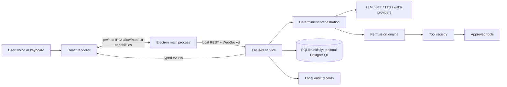

# Architecture

## Status and Principles

This document combines intended boundaries with current implementation status. Phases 1–6 implement the local Python 3.12/FastAPI foundation, validated configuration, SQLite/Alembic lifecycle, typed events, tool registry, permissions/audit, bounded tools, assistant orchestration, persistent masked conversation/task history, the Electron/React desktop client, and an opt-in voice pipeline. Live STT and wake models require operator setup; memory and broader tool integrations remain unavailable. WSL is a practical backend and web-development environment; Windows-native Electron packaging and microphone/device access remain the primary target.

Core principles: local-first processing, explicit permissions, deterministic tool execution, structured LLM output, small modules, typed boundaries, and honest provider health. The LLM proposes plans; application code validates, authorizes, and executes them.

## System Context

The renderer is not a security boundary. Electron main/preload exposes a narrow IPC surface; provider credentials and privileged tool implementations remain in the backend. The backend must bind locally using runtime configuration and reject untrusted origins. No concrete bind address is prescribed in this design baseline.

## Ownership

- `apps/desktop/electron/`: main process, hardened window creation, lifecycle, tray/shortcut integration, and narrow preload bridge.
- `apps/desktop/src/`: React presentation. `app/` owns providers/router; `layouts/` the shell; `pages/` route compositions; `features/` vertical workflows; `components/` shared UI; `hooks/`, `services/`, `state/`, `styles/`, and `types/` own focused shared concerns.
- `apps/api/app/api/`: versioned HTTP routes and WebSocket endpoints. `core/`: settings, logging, errors, lifecycle, dependency wiring. `schemas/`: Pydantic request/event models. `services/`: application service layer.
- `agents/` and `orchestration/`: intent/plan flow and deterministic task lifecycle. `providers/`: provider interfaces and implementations. `audio/`: capture/transcription/playback coordination. `tools/`: SDK/registry and tool implementations. `permissions/`, `security/`, and `memory/`: policy, input boundaries, audit, and scoped memory. `models/` and `workflows/`: persistence and multi-step tasks.
- `packages/shared-types/`: generated/shared event and API contracts; `packages/tool-sdk/`: plugin contracts; `packages/ui/`: reusable design system.
- `config/`: non-secret environment profiles and provider schema. `data/`: ignored local runtime state. `infrastructure/`: later Docker and setup scripts. `tests/`: integration, security, and end-to-end suites.

## Restricted Browser Deployment

`JARVIS_DEPLOYMENT_MODE=browser` and `pwa` run the existing React renderer against the local FastAPI service without importing Electron main/preload modules. The managed Windows supervisor starts the repository virtual-environment Python and existing Vite dependencies, binds both processes to `127.0.0.1`, and records only its own child processes for shutdown. Browser mode uses an exact renderer-origin allowlist and a short-lived session token; the PWA adds an offline application shell but does not execute assistant work offline. Electron remains the default deployment mode when no browser mode is selected and remains an optional target.

## Request and Tool Lifecycle

1. A voice transcript or typed input enters the existing assistant command route with a correlation/task identifier.
2. Typed input is normalized and masked for persistence. The configured LLM planner returns structured intent and plan data; voice does not introduce another planner or execution path.
3. The backend validates tool IDs and arguments against registered schemas, checks enabled state, timeout, risk, and required permission scopes.
4. The permission engine denies, asks, or grants within the selected scope. High-risk and explicitly sensitive actions require user confirmation with masked arguments and affected resources.
5. The registry runs one approved tool at a time, captures structured `ToolResult`, progress, timing, and audit metadata.
6. The response provider summarizes results and sources, persists masked conversation/task records, emits typed events, and returns the response. Optional renderer speech synthesis is interruptible and uses the operating-system default output.

Tool output and retrieved webpages/documents are untrusted data. They cannot add instructions, broaden permissions, or change the plan without a new validated assistant decision.

## API and Event Boundaries

Implemented HTTP routes include health endpoints, voice health/transcription/wake detection, tool discovery/health/enablement/execution, shared permission confirmation/grant operations, paginated audit reads, assistant command submission/status, task status/cancellation, confirmation resolution, paginated assistant history, and LLM health. Conversation/task history is additive through Alembic migration `0003_assistant_history`. Memory, dedicated conversation-management, settings, and desktop routes are not implemented. `/ws/events` supports ping/pong and typed event publishing; audio is sent only through bounded REST requests, and `/ws/audio` remains unimplemented.

Each event uses a validated versioned envelope with `type`, `eventId`, `occurredAt`, `correlationId`, and a type-specific payload. Pydantic event models and in-memory fan-out were implemented in Phase 2. Phases 3–4 publish permission, tool, assistant state/plan/response, progress, and task events through the same typed event hub. Events are ephemeral notifications, not authorization grants or durable audit records. The full event contract includes:

- `assistant.state.changed`, `assistant.plan.created`, `assistant.response.partial`, `assistant.response.completed`
- `voice.wakeword.detected`, `voice.recording.started`, `voice.recording.stopped`, `voice.audio.level`, `voice.speech.started`, `voice.speech.ended`, `voice.transcript.partial`, `voice.transcript.final`, `voice.transcription.failed`, `voice.provider.health.changed`
- `permission.requested`, `permission.resolved`
- `tool.started`, `tool.progress`, `tool.completed`, `tool.failed`
- `audio.playback.started`, `audio.playback.progress`, `audio.playback.completed`, `audio.playback.stopped`
- `task.updated`, `system.metric.updated`, `provider.health.changed`, `notification.created`

See [docs/event-contracts.md](docs/event-contracts.md) for the event contract and [docs/voice-pipeline.md](docs/voice-pipeline.md) for the voice state model.

## Desktop Pages

The renderer routes these page families: Command Center/Home, Conversation, Tasks and Automations, Tools, Memory, Files and Knowledge, System Monitor, Activity and Audit, Settings, Notifications, and Onboarding. The shell owns navigation, system connection/microphone state, command palette, notifications, and shared activity context. Feature/page modules own page-specific query and interaction state. TanStack Query is intended for server state; Zustand for transient client/UI state.

## Persistence and Memory

Async SQLAlchemy, SQLite, Alembic migrations for tool audit/grants, and request-scoped session infrastructure are implemented. Audit records are append-only through the current API surface; audit reads are paginated. An optional asyncpg dependency group and PostgreSQL URL path are available, but have not been integration-tested against a live PostgreSQL server. Persistent stores are local by default. Conversation/session context, user preferences, project memory, and task memory are distinct scopes. Retention, inspect/edit/delete/export controls are required. Secrets, raw credentials, raw private audio, and full sensitive file contents are excluded from memory and logs. Scheduled work must not execute while the desktop is closed unless an explicitly installed/enabled background service is added.

## Configuration and Providers

Provider interfaces isolate backend LLM/STT/wake dependencies; the renderer uses local RMS VAD and the operating-system speech synthesis engine. Mock and operator-configured OpenAI-compatible/Azure OpenAI LLM adapters, optional faster-whisper/Azure STT, and openWakeWord adapters are implemented. Credentials stay backend-side and are never sent to renderer storage. Missing providers report unconfigured rather than fabricated data. Confirmation tickets are currently process-local even though command/task history is persisted. See [PROVIDER_SETUP.md](PROVIDER_SETUP.md).

## Quality Attributes

- Fail closed on permission, schema, provider, and tool-validation errors.
- Keep tool calls bounded by per-tool timeouts and explicit allowlists.
- Propagate correlation IDs across REST, events, tools, and audit records.
- Provide loading, offline, denied, error, and unconfigured states in the UI.
- Use real backend metrics; unavailable metrics are reported as unavailable, not randomized.
- No paid external API calls in automated tests.
